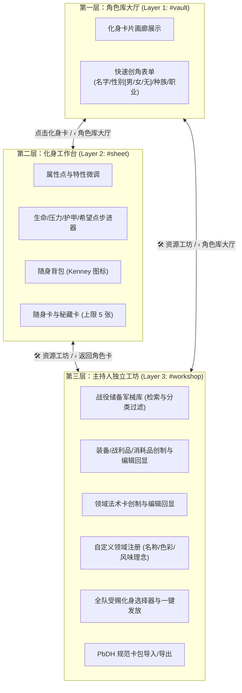

# 《匕首世界》站点与角色库开发交接文档 (Codex 接手指南)

> **更新时间**：2026-11-19 22:40  
> **交接方**：Antigravity Agent  
> **接收方**：Codex Agent / 主持人基德  
> **代码仓库**：`https://github.com/jeffdyuyi/daggerworld-site.git` (`main` 分支)  
> **当前最新 Commit**：`baff772` (`feat: 升级独立主持人资源工坊页面(Layer 3)，支持自定领域与全队装备卡牌即时发放`)

---

## 1. 核心架构与页面层级 (Three-Tier Layer System)

站点目前采用无构建依赖、轻量现代的 ESM 原生架构，运行于静态托管环境（GitHub Pages），并具备 0ms 本地秒开自愈与云端同步双轨机制。整个应用划分为清晰的三层视图：



### 层级控制器实现 (`editor/app.js`):
* `switchLayer(layer, targetIndex)`:
  * `'vault'`：展示 `#layer-vault`，隐藏其它层，URL 写入 `#vault`。
  * `'sheet'`：展示 `#layer-sheet`，隐藏其它层，URL 写入 `#sheet`，触发 `renderAll()`。
  * `'workshop'`：展示 `#layer-workshop`，隐藏其它层，URL 写入 `#workshop`，触发 `initWorkshopLayer()`。
* 状态栏左上角返回按钮 `#btn-back-vault` 具备上下文感知：
  * 在 Layer 2 显示 `‹ 角色库大厅`；
  * 在 Layer 3 显示 `‹ 返回角色卡`（若无角色则回大厅）。
* 支持浏览器前进/后退（`hashchange` 路由监听）。

---

## 2. 核心数据模型与存储规范

### 2.1 角色数据 (`daggerworld.characters.v1`)
```json
{
  "id": "char_1732000000000",
  "avatar_name": "格温",
  "gender": "女", // 男 / 女 / 无
  "sheet": {
    "ancestryId": "人类",
    "communityId": "街头巷尾",
    "classId": "战士",
    "subclassId": "剑刃大师",
    "level": 1,
    "inventoryItems": [
      {
        "name": "精制治疗药水",
        "desc": "**【消耗品 · 药剂】** 恢复 1d8 生命",
        "qty": 2,
        "icon": "🧪",
        "type": "消耗品",
        "subcat": "药剂",
        "tier": 1
      }
    ],
    "equippedDomainCards": [], // 随身装备 (最多5张)
    "customDomainCards": []    // 领域秘藏 (包含战役发放的原创卡)
  }
}
```

### 2.2 战役原创资源与自定领域 (`daggerworld.campaign_resources.v1`)
```json
{
  "name": "深水城2026战役扩展包",
  "version": "1.0.0",
  "author": "主持人基德",
  "description": "深水城战役原创装备、战利品、领域法术卡与自定领域",
  "items": [],
  "domainCards": [],
  "customDomains": [
    {
      "id": "cd_1732000000000",
      "name": "虚空",
      "color": "#8b5cf6",
      "desc": "支配深渊与重力法则，擅长操纵空间与腐化敌人"
    }
  ]
}
```

### 2.3 自定义领域引擎
* **色彩映射表**：`let domainColors = { ... }` 包含官方 11 领域（利刃、骸骨、典籍、优雅、午夜、贤者、辉耀、勇气、奥术、恐怖、秘密）。
* **动态解析器**：`getDomainColor(domainName)` 优先查官方表，未命中则查 `campaignResources.customDomains`，确保卡牌、标签药丸与过滤器背景色 100% 动态对应。
* **卡包导出兼容**：`exportPbDHPack()` 会将自定义领域名称注入 `customFieldDefinitions.domains`，并携带完整的 `customDomains` 元数据；`importPbDHPack()` 支持双向无缝还原。

---

## 3. 重要代码规范与铁律（接手必读）

1. **现有 SRD 规则数据基底只读不可篡改**：
   * `editor/data/database.json` 为官方与本团基础规则数据，绝不可随意覆盖破坏。
2. **严禁代理端启动浏览器验证**：
   * 切勿调用浏览器子代理或外部 curl 探针，主持人基德会在外部真机/线上环境核验。
3. **中文用语杜绝浮夸**：
   * 界面文字严格保持凝练、干练的西幻跑团风格（如“工坊”、“受赐化身”、“随身背包”、“战役储备库”），杜绝冗长堆砌修饰词。
4. **编辑模式原位覆盖（防重复）**：
   * 点击条目 `[ ✏️ 编辑 ]` 时必须带入 `editingId`，保存时覆盖原条目，不可自增重复条目。

---

## 4. 后续建议推进方向 (TODO for Codex)

- [ ] **纸娃娃系统 (Avatar Paperdoll)**：
  * 主持人偏向优先考虑 **LPC Character Generator**（附带丰富美术素材库），可评估通过静态 Sprite 切片方式引入轻量化的像素角色纸娃娃生成与下载/展示组件。
- [ ] **主持人权限与玩家端视图分立**：
  * 玩家选择名字/性别/种族/职业后不可随意更改，仅主持人拥有限权快速调整（模拟 GM 后台及玩家使用改名/变性道具等场景）。
  * 评估国内低成本/无服务器访问体验，进一步优化静态化或极简边缘存储。
- [ ] **战利品与消耗品规则联动**：
  * 增加物品在使用时（点击背包物品使用按钮）的快捷骰子检定或状态点自动扣减/恢复联动。
- [x] **双元骰历史**：
  * 角色属性区可展开最近 10 次检定，记录双骰、属性修正、合计与结果。记录按账号和化身保存在当前浏览器。
  * 已按《匕首之心》修正计分：两颗骰相加再加修正。普通结果提供希望或恐惧倾向，由主持人和难度判定成败；行动检定的关键成功清除 1 点压力。工具记录结果，状态由玩家按实际检定更新。
  * Node VM 已覆盖希望、恐惧、同值、十条上限、刷新回读与账号/化身隔离；页面视觉留真人验收。
